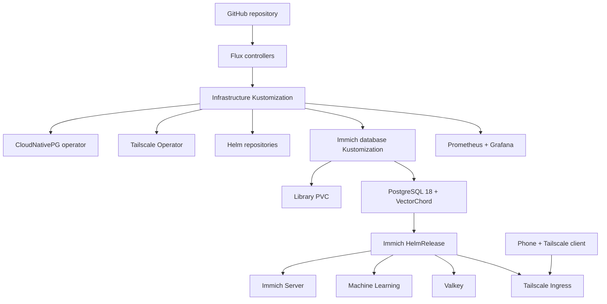

# Arquitectura y dependencias de reconciliación

## Dependencias

- `infrastructure` instala operadores y HelmRepositories.
- `immich-database` espera a `infrastructure` y espera a que CloudNativePG declare saludable el Cluster.
- `immich-app` espera a `immich-database`.
- `immich-access` espera a `immich-app`.
- `monitoring` espera a `infrastructure`.

## Límites de persistencia

Los volúmenes `local-path` viven en el nodo local y se aprovisionan bajo `/srv/homelab/k3s-storage`. No hay replicación. Los volúmenes de PostgreSQL y la biblioteca deben tratarse como datos críticos. No borres PVC/PV para “arreglar” un despliegue sin entender el impacto.
